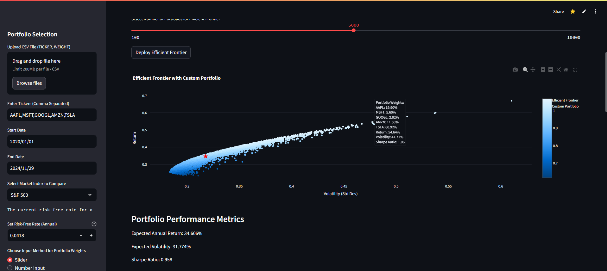

# Portfolio Optimization with Efficient Frontier

This Streamlit application allows users to input a portfolio of stock tickers, select custom portfolio weights via interactive sliders, and visualize the portfolio's performance on the Efficient Frontier. The app provides insights into risk and return trade-offs and helps users find optimal portfolio allocations.

## Features

- **Input Stock Tickers**: Users can enter a list of stock symbols (e.g., AAPL, MSFT, TSLA) to analyze.
- **Adjust Portfolio Weights**: Dynamic sliders allow users to specify the weight of each stock in the portfolio.
- **Efficient Frontier Calculation**: The app computes the Efficient Frontier, which is a set of optimal portfolios that provide the best possible return for a given level of risk.
- **Custom Portfolio Comparison**: Users can compare their custom portfolio to the Efficient Frontier.
- **Interactive Visualization**: The results are displayed on an interactive graph using Plotly, where the Efficient Frontier and the custom portfolio are plotted.

## Getting Started

### Step 1: Clone the Repository

First, clone this repository to your local machine.

### Step 2: Install Dependencies

Use Python 3.11 or 3.12 and install the required Python packages using `pip`.
Streamlit 1.51.0 is pinned because it is the first release that supports custom
light and dark themes together. The other dependency pins are unchanged.

```bash
pip install -r requirements.txt
```

### Step 3: Run the Application

To start the Streamlit application, run the following command in your terminal:

```bash
streamlit run efficient_frontier.py
```

This will start a local web server and open the app in your browser.

### Step 4: Use the App

1. **Enter Tickers**: Input a list of stock tickers (comma-separated) into the text box. For example: `AAPL, MSFT, TSLA`.
2. **Set Date Range**: Specify the start and end dates for historical data fetching.
3. **Adjust Weights**: Use sliders or number inputs to assign non-negative weights. At least one weight must be positive. The app normalizes the proportions to sum to 1 and keeps each weight attached to its ticker when you reorder the list.
4. **Deploy Efficient Frontier**: Click "Deploy Efficient Frontier" to solve the portfolio allocations and compare your portfolio.
5. **View Results**: The plot shows an optimized frontier line, separately labeled random allocation samples, and your custom portfolio. Changing the number of random samples does not change the optimized allocations.

## Appearance: Light and Dark Themes

Open the **top-right menu > Settings > Theme** and choose **Light**, **Dark**,
or **Use system setting**. Both pages use the same themes. Streamlit remembers
your choice in this browser, including when you navigate between pages.
Switching appearance does not change your inputs, allocations, or exports.
If you change your device's appearance while using **Use system setting**,
reload the page to apply it. Choosing **Light** or **Dark** directly updates
the existing charts without a reload.

The palette comes from the blue-and-white Computer Club logo in
`assets/merrimack-computer-club.png`, not Merrimack College's navy-and-gold branding.
Light mode uses a white canvas and a pale blue sidebar; dark mode uses a near-black
canvas, charcoal input surfaces, and brighter blue links. Controls, tables, notices, and Plotly text
and backgrounds follow the selected theme. The attribution at the end of the
portfolio page uses native text instead of a fixed, light-colored overlay.

### Customizing the palettes

Edit `.streamlit/config.toml` from the repository root:

- `[theme.light]` and `[theme.dark]` define background, text, links, controls,
  table headers, and status colors. Their `.sidebar` sections customize sidebar
  surfaces; other values are inherited.
- `[theme]` defines shared chart colors. In Streamlit 1.51, chart palettes belong
  here, **not** in the light/dark sections. Keeping one palette preserves each
  series' identity and avoids depending on a reload to change Plotly data colors.
  All configured chart colors contrast with both chart backgrounds.
- The first five `chartCategoricalColors` entries mean blue frontier/bars, teal
  optimized portfolio, amber selected portfolio, violet benchmark, and gray
  samples with undefined Sharpe ratios. Keep these roles in the same order.
  `chartSequentialColors` must contain exactly ten ordered shades for the Sharpe
  scale. A colorbar and numerical hover values explain that scale.
- Keep primary colors dark enough for **white button labels** in both themes.
  Dark-mode canvas/sidebar backgrounds are near-black so the same primary blue
  also passes 4.5:1 when used for small slider values.
  Aim for at least 4.5:1 text contrast and 3:1 control/chart contrast. The tests
  check these pairs, including faded captions and table headers. Keep links in
  native Markdown, not captions, because Streamlit fades the entire caption.
  Stars, diamonds, labels, and
  distinct historical-return line styles also distinguish series without color.
- Plotly axis, colorbar, and hover labels use 19px bold text: Streamlit's native
  light-mode axis gray meets the 3:1 large-text threshold, but not 4.5:1 for small
  text. Keep those labels large and bold. Legends sit below the plots so they
  do not overlap the colorbar or squeeze the plot on narrow screens.

Restart Streamlit after changing the configuration, and check both modes.
Chart code uses the native `streamlit` Plotly template and its palette, rather
than fixed white backgrounds or per-user server-side theme changes. Avoid
overriding chart text/backgrounds with fixed colors, and run the regression tests
after palette edits. See the [Streamlit theming guide](https://docs.streamlit.io/develop/concepts/configuration/theming)
and the [1.51 release notes](https://docs.streamlit.io/develop/quick-reference/release-notes/2025#version-1510).

## Example

Here’s a quick example of how to use the app:

- Input the tickers `AAPL, MSFT, TSLA` in the ticker field.
- Set the portfolio weights using the sliders (e.g., 40% AAPL, 30% MSFT, 30% TSLA).
- Click "Deploy Efficient Frontier" to visualize the portfolio’s performance against the Efficient Frontier.

## How the Portfolio Calculations Work

- **A real efficient frontier, not a random cloud.** The app uses SciPy's constrained
  optimizer to find the lowest variance for each target return. The curve starts
  at the global minimum-variance portfolio and ends at the highest feasible return.
  Weights cannot be negative and must sum to 100%. Maximum Sharpe ratio is solved
  separately, rather than choosing the luckiest random sample. Solver failures
  and infeasible results are reported instead of used as allocations.
- **Return and risk use the same units.** Daily simple returns come from adjusted
  closing prices. Expected annual return is the weighted daily average times 252.
  Annual variance is `252 * weights.T @ daily_covariance @ weights`; volatility
  is its square root. These are historical, arithmetic estimates, not compound
  growth rates or predictions. Sharpe ratio is `(annual_return - annual_risk_free_rate)
  / annual_volatility`. It is undefined at effectively zero volatility; the app
  does not invent a finite maximum-Sharpe allocation in that case.
- **Inputs are checked before use.** Empty/duplicate tickers, invalid dates,
  negative/non-finite weights, and all-zero allocations are rejected. Yahoo's
  response columns are matched by ticker, not by their position in a download.
  The annual risk-free input is a decimal: `0.04` means 4%. The latest 10-year
  Treasury yield is only a proxy; if it cannot be loaded, enter a rate manually.
- **Missing prices are not invented.** Start Date is inclusive and End Date is
  exclusive. Estimates use the shared available history for all selected assets,
  with the effective dates shown on the page. At least three closing prices
  (two daily returns) are required. Missing prices inside that window cause an
  error instead of being forward-filled into fake zero returns. A benchmark
  comparison also requires matching closing dates, so a multi-day market return
  is not compared with a one-day portfolio return.
- **Historical comparisons rebalance daily.** Both the selected and optimized
  portfolios return to their fixed weights each trading day. This is not a
  buy-and-hold simulation. The daily-return chart is labeled as daily; the
  cumulative chart compounds returns as `(1 + daily_returns).cumprod() - 1`
  and includes a common zero-return starting point.
- **Alpha and beta use daily excess returns.** The annual risk-free rate is
  divided by 252. Beta is the slope against the benchmark using the same dates;
  alpha is the daily excess-return intercept multiplied by 252. Alpha is not
  calculated by adding up a varying number of daily returns and subtracting an
  annual rate. Both values are undefined if the benchmark has no variation.

### Limitations

The optimized historical comparison is **in-sample (hindsight)**: its weights
were fitted using the estimation history, not a separate training period.
It is not evidence of future performance. Short histories, redundant assets,
and noisy historical means can produce unstable allocations or near-zero
estimated risk. All-below-risk-free estimates are called out because maximizing
a negative Sharpe ratio can favor higher risk.

The model assumes 252 trading days per year, a constant annual risk-free input,
daily rebalancing, no short selling or leverage, and no transaction costs or
taxes. Annualized volatility uses the usual uncorrelated-daily-return assumption.
It does not convert currencies. Stocks use dividend/split-adjusted
closes, while the selected market indexes are **price indexes**, not comparable
dividend-reinvested total-return indexes. The page explicitly notes this
benchmark limitation. Yahoo data and company names are cached for one hour;
request failures are shown, not cached as successful data.

### Portfolio CSV Format

Uploads use one row of tickers and an optional second row of weights:

```csv
MSFT,AAPL
0.6,0.4
```

One-row uploads receive equal weights. Positive totals other than 1 are
normalized; invalid or incomplete rows are rejected. Selected and optimized
portfolio downloads use this same format. The separate sub-portfolio download
is a reporting table in percentage units: its weights sum to the chosen share
of a larger portfolio, whose remaining assets are not modeled. It is not an
upload-format portfolio.

### Calculation References

- [Stanford/CVX portfolio optimization notes](https://www.cvxgrp.org/cvx_short_course/docs/applications/notebooks/portfolio_optimization.html): weighted return, covariance risk, and constrained optimal trade-offs. This app uses SciPy, not CVXPY.
- [William Sharpe, The Sharpe Ratio](https://web.stanford.edu/~wfsharpe/art/sr/SR.htm): excess returns and consistent time periods.
- [pandas 2.2 `pct_change`](https://pandas.pydata.org/pandas-docs/version/2.2/reference/api/pandas.DataFrame.pct_change.html): fractional returns and explicit `fill_method=None`.
- [SciPy SLSQP](https://docs.scipy.org/doc/scipy-1.14.1/reference/optimize.minimize-slsqp.html): constrained numerical optimization.

## Analyst Recommendations

Open **analyst recommendations** in the sidebar and select a market index.
The page compares the individual companies in that index, not the index itself,
with their mean analyst price targets from Yahoo Finance.

- Supported lists: S&P 500, NASDAQ-100, Russell 1000, Dow Jones, FTSE 100,
  Nikkei 225, and SSE Composite. US/UK constituents come from Wikipedia, Nikkei
  constituents from TopForeignStocks, and SSE constituents from China Securities
  Index's downloadable list. The Nikkei source is dated January 2024 and may
  not reflect subsequent index changes; source links are shown on the page.
- Symbols are converted to Yahoo Finance format, including US share classes
  (`BRK.B` becomes `BRK-B`), London (`.L`), Tokyo (`.T`), and Shanghai (`.SS`).
- **Current Price** is the latest closing price, not a live quote. Price changes
  exclude dividends and use the last available close on or before the comparison
  date. YTD starts with the previous year's final close.
- Missing analyst coverage or insufficient history appears as a blank value,
  not a zero or an invented recommendation. Prices remain visible when a target
  request fails, and request failures are shown separately.
- Prices and targets are in each stock's quoted currency/unit (for example,
  London prices may be quoted in pence). They are not converted to a common currency.
- Constituents are cached for one day and stock data for one hour. **Refresh data**
  clears these caches. Large indexes can take several minutes; progress is shown.
  If Yahoo Finance limits requests, wait before retrying.

## Regression tests

Run the offline numerical, CSV/data-validation, theme/contrast, and Streamlit interaction tests
after installing `requirements.txt`. They also cover the analyst page without
making network requests:

```bash
python -m unittest discover -s tests -v
```

## Screenshots

  <!-- Add a screenshot of your app here -->

## License

This project is licensed under the MIT License - see the [LICENSE](LICENSE) file for details.
```

### Additional Instructions:
- Replace `<repository-url>` with your actual repository URL.
- Replace `<repository-folder>` with the name of your cloned repository.
- Add an actual screenshot by placing it in the same folder as `README.md` and calling it `screenshot.png`, or modify the image path to reflect your file's name.
- Ensure you generate the `requirements.txt` file for all package dependencies:
  ```bash
  pip freeze > requirements.txt
  ```

This markdown is now ready to be copied and used as your `README.md` file.
